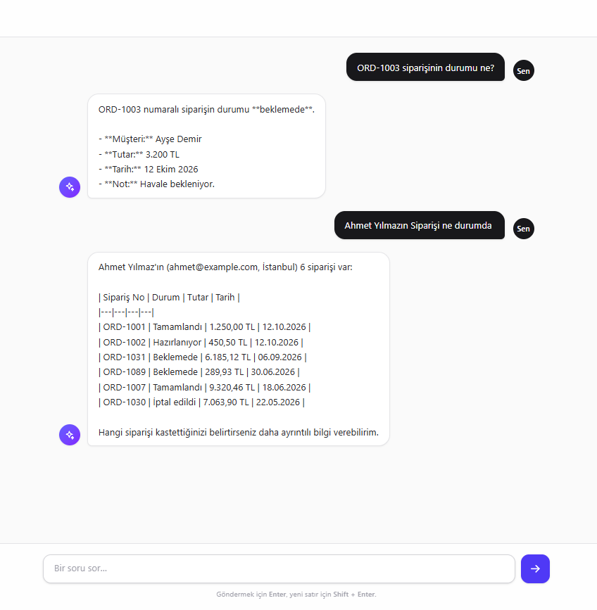

<p align="right"><b>Türkçe</b> · <a href="README.en.md">English</a></p>

# Sipariş Asistanı

> Laravel ve Anthropic Claude ile geliştirilmiş, Türkçe konuşan müşteri hizmetleri asistanı.

[](https://github.com/bykeremx/anthropic-agent-laravel/actions/workflows/tests.yml)

Kullanıcı sohbet ekranına doğal dilde soru yazar. Model gerektiğinde veritabanını **tool use (function calling)** ile sorgular ve gerçek veriye dayanan bir cevap üretir.



```
"ORD-1003 siparişinin durumu ne?"
        → model get_order_status aracını çağırır
        → Laravel siparişi veritabanından okur
        → "ORD-1003 numaralı sipariş beklemede, tutarı 3.200,00 TL."
```

## Özellikler

- **Ajan döngüsü:** Model tool ister → uygulama çalıştırır → sonuç modele geri beslenir; en fazla 5 tur.
- **İki tool:**
  - `get_customer_orders` — isim/soyisim ile müşteri arar (en fazla 5 eşleşme), siparişleri ve iptaller hariç toplam harcamayı döner.
  - `get_order_status` — sipariş numarasıyla tek siparişi getirir (`1003`, `ord-1003` gibi girdileri `ORD-1003`'e tamamlar).
- **Güvenli tool çağrısı:** Model yalnızca `ToolSchema`'da tanımlı tool'ları çalıştırabilir.
- **Ek SDK yok:** Anthropic Messages API'ye Laravel `Http` istemcisiyle doğrudan istek atılır.
- **Hata yönetimi:** API hataları 502, beklenmeyen hatalar 500 olarak döner ve loglanır; kullanıcıya iç detay gösterilmez.

## Mimari

```
Tarayıcı (x-ai.chat)
   │  POST /ai/agent/send  {message}
   ▼
AgentController ── doğrulama (required|string|max:2000)
   │
   ▼
AiAgent::run() ─────────────► ToolSchema::all()   (modele sunulan tool tanımları)
   │   ▲
   │   │ tool_result
   ▼   │
AiClient::send() ──► Anthropic Messages API
   │
   │ stop_reason == tool_use ?
   ├── evet ──► ToolsService::call() ──► Eloquent (customers, orders)
   └── hayır ─► AiAgent::text() ──► {"reply": "..."}
```

| Dosya | Görevi |
|---|---|
| `app/Http/Controllers/Ai/AgentController.php` | HTTP girişi: doğrular, ajanı çalıştırır, hatayı/cevabı JSON'a çevirir |
| `app/Services/Ai/AiAgent.php` | Orkestratör: system prompt, tool listesi, sınırlı tool-use döngüsü |
| `app/Services/Ai/AiClient.php` | Anthropic Messages API'ye tek HTTP çağrısı |
| `app/Services/Ai/ToolsService.php` | Tool uygulamaları (Eloquent sorguları, whitelist kontrolü) |
| `app/Schema/ToolSchema.php` | Modele gösterilen tool tanımları (ad, açıklama, JSON Schema) |
| `resources/views/components/ai/chat.blade.php` | Sohbet arayüzü |

## Gereksinimler

- PHP **8.4+** (`composer.lock` 8.4 gerektirir)
- Composer
- Node.js ve npm (arayüz asset'leri için)
- SQLite (varsayılan) veya Laravel'in desteklediği başka bir veritabanı
- Bir [Anthropic API anahtarı](https://console.anthropic.com/)

## Kurulum

```bash
git clone https://github.com/bykeremx/anthropic-agent-laravel.git
cd anthropic-agent-laravel

composer install
cp .env.example .env
php artisan key:generate
```

`.env` dosyasına Anthropic bilgilerini ekleyin:

```dotenv
ANTHROPIC_API_KEY=sk-ant-...
ANTHROPIC_MODEL=claude-haiku-5-5
```

Veritabanını oluşturup örnek verilerle doldurun (30 müşteri, 100 sipariş):

```bash
touch database/database.sqlite      # SQLite kullanıyorsanız
php artisan migrate --seed
```

Arayüz asset'lerini derleyin:

```bash
npm install
npm run build
```

## Çalıştırma

- **Laravel Herd:** Proje klasör adıyla otomatik olarak yayınlanır (ör. `http://anthropic-agent-laravel.test`).
- **Herd olmadan:** `composer run dev` (sunucu, queue ve Vite birlikte çalışır) veya `php artisan serve`.

Asistan sayfası: **`/ai/agent`**

Seed verisiyle deneyebileceğiniz örnek sorular:

- `Ahmet Yılmaz'ın siparişleri neler?`
- `ORD-1003 siparişinin durumu ne?`
- `Ayşe Demir toplam ne kadar harcamış?`
- `Mehmet isimli müşterilerin siparişlerini listele.`

## Uç noktalar

| Metot | URL | Route adı | Açıklama |
|---|---|---|---|
| GET | `/ai/agent` | `ai.agent` | Sohbet sayfası |
| POST | `/ai/agent/send` | `ai.send` | Mesaj gönderir (`{"message": "..."}`) |

Yanıtlar:

| Durum | Gövde |
|---|---|
| 200 | `{"reply": "..."}` |
| 422 | Doğrulama hatası (`{"message": "...", "errors": {...}}`) |
| 502 | `{"message": "AI servisine ulaşılamadı. Lütfen tekrar dene."}` |
| 500 | `{"message": "Beklenmeyen bir hata oluştu."}` |

> POST isteği `web` middleware grubundadır; `X-CSRF-TOKEN` header'ı gerekir.

## Testler

Testler [Pest](https://pestphp.com) ile yazılmıştır. Anthropic API'si `Http::fake()` ile taklit edilir; **testler için API anahtarı gerekmez ve hiçbir istek internete çıkmaz.**

```bash
php artisan test
```

| Test dosyası | Kapsam |
|---|---|
| `tests/Feature/Http/Controllers/Ai/AgentControllerTest.php` | Sayfa, doğrulama, başarılı cevap, 502/500 hata dalları |
| `tests/Feature/Services/Ai/AiAgentTest.php` | Ajan döngüsü, tool_result eşleşmesi, paralel tool'lar, 5 adım sınırı |
| `tests/Feature/Services/Ai/AiClientTest.php` | Header'lar, payload, hata durumunda exception |
| `tests/Feature/Services/Ai/ToolsServiceTest.php` | Müşteri/sipariş sorguları, normalizasyon, whitelist |
| `tests/Unit/Schema/ToolSchemaTest.php` | Her tool tanımının bir `ToolsService` metoduna karşılık gelmesi |

### Sürekli entegrasyon

`.github/workflows/tests.yml`, `main`/`master` dalına her push'ta ve her Pull Request'te testleri PHP 8.4 üzerinde çalıştırır. GitHub'da **Actions → Tests → Run workflow** ile elle de başlatılabilir. Herhangi bir secret tanımlamanız gerekmez.

## Yeni bir tool eklemek

1. `app/Schema/ToolSchema.php` içindeki `all()` dizisine yeni tanımı ekleyin: `name`, ne zaman kullanılacağını (ve kullanılmayacağını) anlatan bir `description` ve `input_schema`.
2. `app/Services/Ai/ToolsService.php` içine **aynı isimde** public bir metot ekleyin. Metot `array $input` almalı ve `['status' => 'success', ...]` ya da `['status' => 'error', 'message' => '...']` döndürmelidir.
3. Gerekirse `AiAgent` içindeki system prompt'a tool ile ilgili davranış kuralı ekleyin.
4. `ToolsServiceTest.php` dosyasına testlerini yazın. `ToolSchemaTest`, tanımla metodun eşleştiğini otomatik olarak kontrol eder.

## Bilinen sınırlamalar

- Sohbet geçmişi tutulmaz; her mesaj bağımsız olarak işlenir.
- AI uç noktalarında kimlik doğrulama ve rate limiting yoktur. Canlıya almadan önce `auth` ve `throttle` middleware'leri eklenmelidir.
- Müşteri adı, e-posta, şehir ve sipariş bilgileri Anthropic API'sine gönderilir; KVKK açısından değerlendirilmelidir.

## Lisans

[MIT](https://opensource.org/licenses/MIT)
